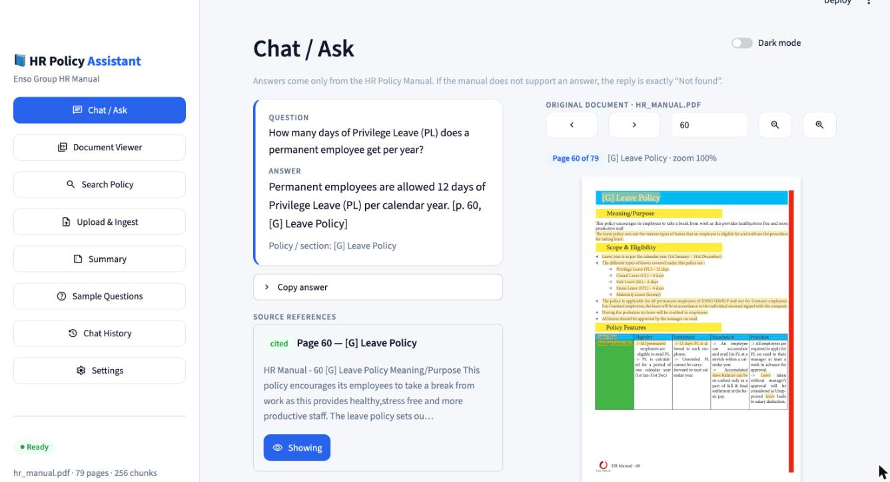
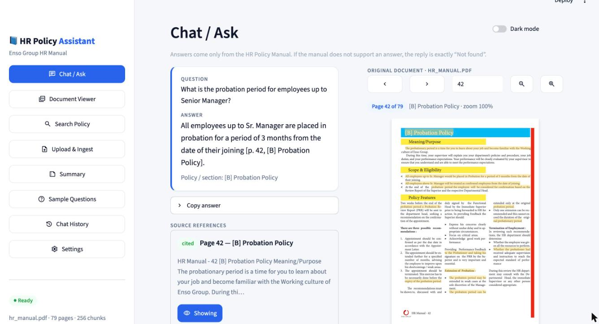
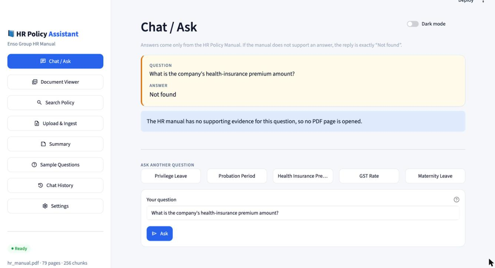
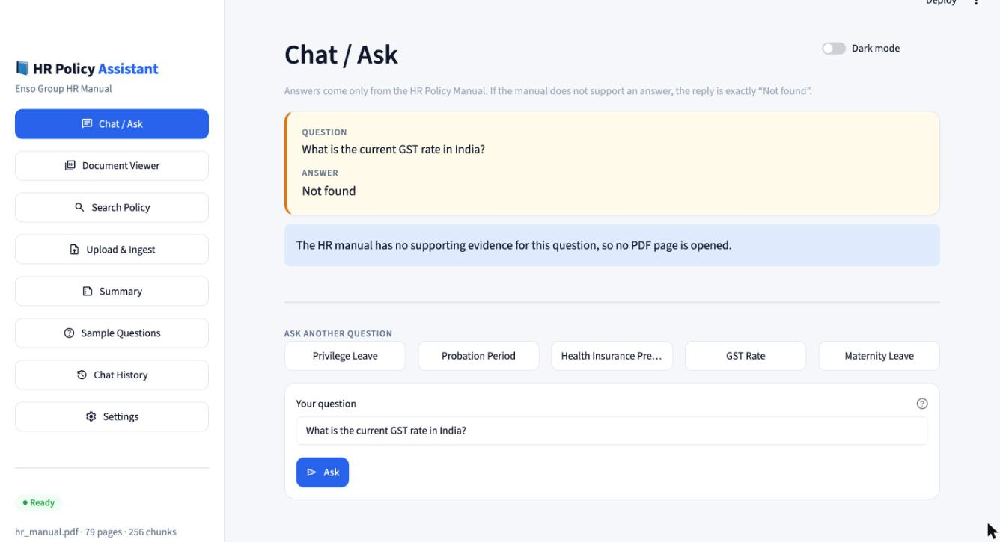
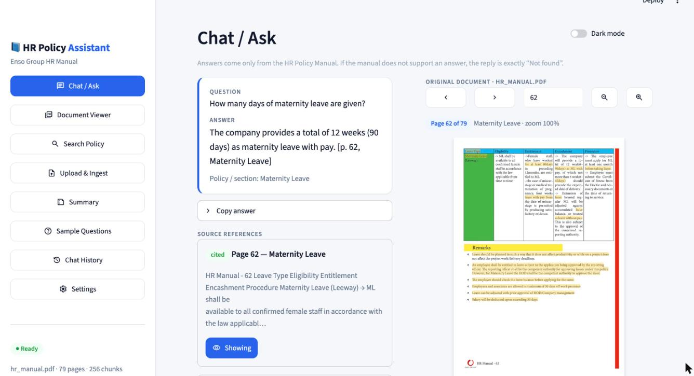

# HR Policy Assistant

A retrieval-augmented (RAG) assistant that answers employee questions **only** from the
**Enso Group HR Policy Manual** (`hr_manual.pdf`, 79 pages). Every answer cites the PDF page and policy
section, and the cited page opens next to the answer. If the manual does not support an answer, the reply is
exactly `Not found`.

Built with **Python 3.12, LangChain, ChromaDB, Streamlit and Google Gemini**.

## Features
- **Chat / Ask**: type a question (Enter submits) or use a suggestion chip.
  - The answer card has a copy button and source cards with page and section.
  - **The cited PDF page opens automatically beside the answer.** Clicking another source switches the page.
  - A `Not found` answer opens no page.
- **Document Viewer**: the real PDF, rendered with pdf.js.
  - Previous/next buttons, page box, "Page X of N", zoom.
  - Matching words are highlighted, and the extracted page text is shown.
- **Search Policy**: keyword search over the manual's page text, with excerpts, page, section and **View page**.
- **Upload & Ingest**:
  - Checks that an uploaded file is a readable PDF before it replaces the manual.
  - Re-ingest button; shows page and chunk counts and when the last ingest finished.
  - Chunks from an older PDF are removed, so the index never holds duplicates.
- **Summary**: concise or detailed summaries built only from retrieved pages, with page references, or `Not found`.
- **Sample Questions**, **Chat History** (stored locally, reopen, clear with confirmation), **Settings / status**.
- **Light and dark themes**: toggle in the header; the choice is kept in the URL (`?theme=dark`).

## Architecture
```
data/hr_manual.pdf
  └─ pypdf: one text per page, page numbers are 1-based (index + 1)
     └─ RecursiveCharacterTextSplitter (900 chars, 150 overlap) + section-heading detection
        └─ local MiniLM embeddings (Chroma's ONNX model, no API key)
           └─ ChromaDB in chroma_db/ (ids = content hash → re-ingest never duplicates)

question → top-5 similarity search → grounding check (the question's key terms must appear in the retrieved text)
         → Gemini (langchain-google-genai) with an "excerpts only, else reply Not found" prompt
         → citation check: page numbers Gemini cites must belong to retrieved chunks, otherwise they are replaced
         → answer + sources → the top cited page opens in the PDF viewer
```
If Gemini is unavailable (no key, wrong model, network), the app falls back to quoting the best matching sentence
from the retrieved text, still with a page citation, or `Not found`.

| Path | Purpose |
|---|---|
| `app.py` | Streamlit dashboard (all views) |
| `hr_assistant/ingest.py` | PDF loading, chunking, ChromaDB upsert, ingest metadata |
| `hr_assistant/rag.py` | retrieval, grounding check, Gemini answering, citation check, summaries |
| `hr_assistant/pdf_tools.py` | page text, keyword search, highlighting, pdf.js viewer, page helpers |
| `hr_assistant/sections.py` | policy/section heading detection |
| `hr_assistant/history.py` | local chat history (`data/history.json`) |
| `ask.py` / `ingest.py` | command-line question answering / ingestion |
| `tests/` | unit and feature tests; the five-question tests run when the PDF is present |

## Setup (macOS)
Requires Python 3.12 (`brew install python@3.12`).

```bash
./setup.sh
```
`setup.sh` does the following:
- recreates this project's `.venv` with `python3.12`;
- installs `requirements.txt` and checks the imports;
- runs the tests;
- creates `.env` from `.env.example` if it is missing.

In VS Code, run **Terminal → Run Task → "Setup (venv + install + tests)"** instead.

### Gemini API key
Edit `.env` (it is git-ignored):
```
GEMINI_API_KEY=your_gemini_api_key_here
GEMINI_MODEL=gemini-2.5-flash-lite
```
Without a key the app still works in extractive mode.

### The HR manual
Download it from the
[Enso Group website](https://www.ensogroup.com/wp-content/themes/ensogroup/assets/images/enso-images/hr_manual.pdf)
and either put it at `data/hr_manual.pdf` or upload it in **Upload & Ingest**. The PDF is not committed to this repository.

### Ingest / re-ingest
```bash
.venv/bin/python ingest.py
```
You can also use **Upload & Ingest → Re-ingest** in the app, or the VS Code task **"Ingest PDF"**.

### Run
```bash
.venv/bin/python -m streamlit run app.py
```
Open http://localhost:8501. In VS Code: **Run Task → "Run HR Assistant (Streamlit)"** (⇧⌘B), or F5.

Command line: `.venv/bin/python ask.py --eval` runs the five assignment questions.

### Tests
```bash
.venv/bin/python -m pytest -q
```

## Assignment Questions and Verified Answers
Each question was typed into the running app's question box and submitted with Enter. The answers below are
what the app returned (Gemini `gemini-2.5-flash-lite`). They were then checked by hand against the text of
`hr_manual.pdf`. The screenshots are unedited captures of the app.

### 1. How many days of Privilege Leave (PL) does a permanent employee get per year?
**App answer:** Permanent employees are allowed 12 days of Privilege Leave (PL) per calendar year. [p. 60, [G] Leave Policy]

**Source:** page 60, *[G] Leave Policy*. Under Scope & Eligibility the manual says "Privilege Leave (PL) – 12 days".



*The screenshot shows the submitted question and the cited answer on the left, with the original PDF opened
automatically at page 60 of 79 ("HR Manual - 60" in the footer) on the right. The PL entitlement is highlighted.*

### 2. What is the probation period for employees up to Senior Manager?
**App answer:** All employees up to Sr. Manager are placed in probation for a period of 3 months from the date of their joining [p. 42, [B] Probation Policy].

**Source:** page 42, *[B] Probation Policy* (Annexure I), Scope & Eligibility.



*The answer sits beside page 42 of 79. The "All employees up to Sr. Manager would be placed in Probation for a
period of 3 months" line is highlighted.*

### 3. What is the company's health-insurance premium amount?
**App answer:** `Not found`

**Source:** none. The manual does not state any health-insurance premium; the only insurance it mentions is
travel insurance (page 71).



*The app returns exactly `Not found`, explains that the manual has no supporting evidence, and opens no PDF page.*

### 4. What is the current GST rate in India?
**App answer:** `Not found`

**Source:** none. GST does not appear anywhere in the manual, and the app does not use outside knowledge.



*The app returns exactly `Not found` and opens no page.*

### 5. How many days of maternity leave are given?
**App answer:** The company provides a total of 12 weeks (90 days) as maternity leave with pay. [p. 62, Maternity Leave]

**Source:** page 62, *Maternity Leave* (Leave Policy table). The manual says "a total of 12 weeks (90days) as ML
with pay, of which not more than 6 weeks (45days) should precede the expected date of delivery".



*The answer sits beside page 62 of 79 with the maternity-leave entitlement highlighted. The other retrieved
sources (pages 60 and 18) are listed below the answer and can be opened with one click.*

### Summary
| # | Question | Answer | Page / section |
|---|---|---|---|
| 1 | Privilege Leave per year | 12 days | p. 60, [G] Leave Policy |
| 2 | Probation up to Senior Manager | 3 months from joining | p. 42, [B] Probation Policy |
| 3 | Health-insurance premium | Not found | — |
| 4 | Current GST rate in India | Not found | — |
| 5 | Maternity leave | 12 weeks (90 days) with pay | p. 62, Maternity Leave |

## Security
- `.env`, `.venv/`, `chroma_db/`, `static/`, `data/*.pdf`, `data/history.json` and caches are git-ignored.
- The API key is read from `.env` only and is never shown in the UI, logs or history.

## Known limitations
- The PDF viewer loads pdf.js from cdnjs, so the browser needs internet access.
- Section names are detected from headings in the extracted text. A few are imperfect (for example, a numbered list
  item on page 43); page numbers are always the real PDF pages.
